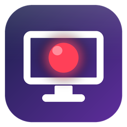

<p align="center">
  
</p>

<h1 align="center">CaptureDeck</h1>

<p align="center">USB 캡쳐 보드용 가벼운 녹화 프로그램 · 예약 녹화 · 영상 자르기 (Windows)</p>

---

OBS처럼 매번 장면·소스를 세팅할 필요 없이, **실행하면 바로 미리보기가 뜨고 버튼 하나로 녹화**할 수 있도록 만든 USB3 캡쳐 프로그램입니다.

## 주요 기능

### 영상 캡쳐
- 실행 즉시 저장된 장치(또는 자동 감지된 USB 캡쳐 장치)로 **미리보기 + 오디오 레벨** 표시
- 영상 + 오디오를 함께 녹화해 **MP4**로 저장
- NVIDIA GPU가 있으면 **NVENC 하드웨어 인코딩**, 없으면 CPU x264(ultrafast) 자동 선택
- 장치가 지원하는 해상도/FPS를 자동으로 확인 (1080p, 720p, 4K 등 / 60·30·25·24fps)
- **소리 듣기(모니터링)**: 캡쳐 중인 오디오를 PC 스피커로 출력
- 장치 신호가 끊기면 **자동 재연결**
- 녹화·예약 중에는 PC **절전 모드 진입 방지**

### 예약 녹화
- **시간 지정**: `14:30`부터 `16:00`까지처럼 시작/종료 시각 지정
- **지금부터 N분간**: 바로 시작해서 지정한 시간만큼 녹화
- 예약 중에도 **종료 시간 변경** 가능

### 영상 자르기
- 녹화한(또는 임의의) 영상을 열어 재생하며 구간 선택
- 1프레임 / 1초 단위 이동, 시간 직접 입력(`00:01:23.456`)으로 이동
- **밀리초 단위**로 시작·끝 지정 후 `_trim` 파일로 저장 (원본은 보존)
- "녹화 종료 후 바로 편집" 옵션을 켜면 녹화가 끝나자마자 자르기 탭에서 열림
- 단축키: 자르기 탭에서 `Space` = 재생/일시정지

### 설정 자동 저장
장치, 해상도, FPS, 저장 폴더, 예약 설정, 창 위치 등 마지막 설정이 실행 파일과 같은 폴더의 `settings.ini`에 자동 저장됩니다.

## 요구 사항
- Windows 10 / 11
- Python 3.10 이상 (소스로 실행하거나 빌드할 때)
- USB 캡쳐 장치 (DirectShow로 인식되는 장치)

## 설치 및 실행

```bash
pip install opencv-python sounddevice numpy pillow pygrabber imageio-ffmpeg
```

```bash
python usb3_capture.py
```

FFmpeg는 `imageio-ffmpeg` 패키지에 포함된 실행 파일을 사용하므로 따로 설치할 필요가 없습니다.

## exe 빌드

PyInstaller로 단일 실행 파일을 만듭니다.

```bash
pip install pyinstaller
```

```bash
build.bat
```

빌드가 끝나면 `dist\CaptureDeck.exe`가 생성됩니다. `build.bat`은 빌드 전에 `make_icon.py`로 아이콘(`capturedeck.ico`, `capturedeck.png`)을 다시 만듭니다.

## 파일 구성

| 파일 | 설명 |
| --- | --- |
| `usb3_capture.py` | 프로그램 본체 (캡쳐 · 예약 녹화 · 자르기 UI) |
| `build.bat` | PyInstaller 빌드 스크립트 |
| `make_icon.py` | 앱 아이콘 생성 스크립트 (Pillow) |
| `version_info.txt` | exe 파일 버전 정보 |
| `capturedeck.ico` / `capturedeck.png` | 앱 아이콘 |

## 녹화 동작 방식
1. 녹화 중에는 영상을 H.264로 인코딩해 임시 `.tmp.mkv`, 오디오는 `.tmp.wav`로 따로 저장합니다.
2. 녹화가 끝나면 영상은 재인코딩 없이 복사하고 오디오만 AAC로 변환해 하나의 `.mp4`로 합칩니다.
3. 합치기에 성공하면 임시 파일은 삭제되고, 실패하면 임시 파일이 그대로 남아 복구할 수 있습니다.

기본 저장 위치는 `내 비디오\Captures` 폴더이며, 화면에서 변경할 수 있습니다.
