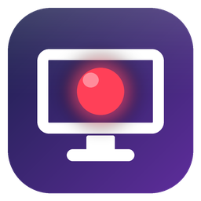

<p align="center">
  
</p>

<h1 align="center">CaptureDeck</h1>

<p align="center">USB 캡쳐 보드용 가벼운 녹화 프로그램 · 예약 녹화 · 영상 자르기 (Windows)</p>

---

OBS처럼 매번 장면·소스를 세팅할 필요 없이, **실행하면 바로 미리보기가 뜨고 버튼 하나로 녹화**할 수 있도록 만든 USB3 캡쳐 프로그램입니다.

## 주요 기능

### 영상 캡쳐
- 실행 즉시 저장된 장치(또는 자동 감지된 USB 캡쳐 장치)로 **미리보기 + 오디오 레벨** 표시
- 영상 + 오디오를 함께 녹화해 **MP4**로 저장
- NVIDIA GPU가 있으면 **NVENC 하드웨어 인코딩**, 없으면 CPU x264(ultrafast) 자동 선택
- 장치가 지원하는 해상도/FPS를 자동으로 확인 (1080p, 720p, 4K 등 / 60·30·25·24fps)
- **소리 듣기(모니터링)**: 캡쳐 중인 오디오를 **듣는 장치**(스피커·헤드폰·모니터)로 출력. 캡쳐 보드로 들어가는 출력(예: `HD TO USB`)을 고르면 안 들리고 녹화에 소리가 겹칠 수 있어 경고
- 장치 신호가 끊기면 **자동 재연결**
- 녹화·예약 중에는 PC **절전 모드 진입 방지**

### 예약 녹화
- **시간 지정**: `14:30:00`부터 `16:00:15`까지처럼 시작/종료 시각을 **초 단위**로 지정 (`14:30`처럼 초를 생략해도 됨)
- **지금부터 N시간 N분 N초간**: 바로 시작해서 지정한 시간만큼 녹화, 몇 시 몇 분 몇 초에 끝나는지 실시간 표시
- 예약 중·녹화 중에도 **종료 시간 / 지금부터 시간 변경** 가능
- 직접 녹화하고 있을 때 예약하면 그 녹화를 이어받아 지정한 시각에 자동으로 멈춤

### 시작 화면: 자동 녹화 / 직접 녹화
- 실행하면 먼저 모드를 고름 (마지막으로 고른 모드가 기본, `←` `→` + `Enter`로도 선택)
- **자동 녹화**: 온라인 강의 연속 녹화 화면 하나 (미리보기 · 캡쳐 장치 / 저장·파일 이름·인코딩 설정 탭 · 강의 표 · 작업)
- **직접 녹화**: `영상 캡쳐` / `녹화 복구` / `영상 자르기` / `용량 줄이기` 탭

### 온라인 강의 연속 자동 녹화 (해커스 나의 강의실)
- **① 자동녹화용 Edge 열기** (전용 프로필, 처음 한 번만 로그인)
- ② 그 Edge에서 나의 강의실 → 강좌를 눌러 강의 목록을 펼쳐 둠
- ③ **LESSON 추가**: `제 1 강`, `제 1 강, 제 2 강`, `제 1 강 ~ 제 3 강`, `1~3`, `1, 2, 3` 처럼 쉼표·줄바꿈·범위 모두 인식. Edge 목록에서 찾은 강의만 표에 추가되고, 못 찾은 줄은 이유와 함께 입력 창에 남음
- **강의 표**: `일련번호` / `강의 제목` / `길이` / `작업` / `상태`. 항상 일련번호 오름차순, 바뀔 때마다 바로 저장돼서 다시 열어도(갑자기 꺼져도) 그대로 복원. 상태·제목에 마우스를 올리면 잘린 글자 전체가 툴팁으로 보임. `Delete` / **선택 삭제** / **모두 지우기**로 정리
- **작업** (표에서 오른쪽 클릭으로 변경): `녹화` / `인코딩` / `녹화 및 인코딩`(기본) / `건너뛰기`
- **상태 변경** 콤보박스(또는 오른쪽 클릭 › 상태 변경): `녹화 대기` / `녹화 중` / `녹화 완료` / `인코딩 대기` / `인코딩 중` / `인코딩 완료` / `건너뛰기` (`녹화 중`·`인코딩 중`은 작업이 진행되면 저절로 바뀜). 상태에 맞게 작업도 바뀜 (예: `인코딩 대기`로 바꾸면 작업에 인코딩이 들어감). 작업 중에 `녹화 대기`로 바꾸면 지금 하는 강의들이 끝난 뒤 이어서 녹화
- **상태** 칸: `녹화 대기` · `녹화 중(진행률: 42.5%, 27분 30초 남음)` · `녹화 완료` · `인코딩 대기` · `인코딩 중(진행률: 50.0%, 1분 1초 남음)` · `인코딩 완료` · `파일이 존재하지 않습니다.` · `사용자가 녹화 도중 작업을 중지했습니다.` · `사용자가 인코딩 도중 작업을 중지했습니다.` · `사용자가 해당 강의의 작업을 진행하지 않도록 상태를 변경했습니다.`(건너뛰기) · `녹화 실패: ...` · `인코딩 실패: ...`
- **상태 체크**: 강의마다 녹화 원본·인코딩한 파일이 있는지, 열리는지, 끝까지 녹화됐는지(영상 길이 비교) 확인해서 상태를 고침. 파일 이름 형식이 바뀌었어도 `제 N 강`으로 시작하는 파일을 찾음. 인코딩 중이면 잠시 멈췄다가 체크가 끝나면 이어서 진행
- **비정상 파일 자동 감지**: 표의 길이(녹화할 때 확인한 실제 영상 길이)보다 3초 넘게 짧거나, 길이를 모르는데 5분보다 짧거나, 용량이 100kbps 미만(거의 빈 화면)이거나, 파일이 안 열리면 다시 녹화할 강의로 바꿈. 녹화 직후·인코딩 직후·프로그램을 열 때·LESSON 추가 때·`상태 체크` 때 확인하고, 정상일 때만 인코딩
- **작업** 설정 (작업 중에 바꾸면 다음 파일부터 적용):
  - `녹화 완료 후 바로 인코딩` / `모든 녹화가 완료된 후 인코딩` / `녹화만 진행`
  - `인코딩 완료 후 원본파일 제거` (휴지통으로)
  - `작업 완료 후 컴퓨터 종료` (실행할 때마다 꺼진 상태): 녹화·MP4 변환·인코딩이 모두 끝나면 60초 카운트다운 뒤 종료 (취소 가능, `중지`로 멈춘 경우엔 끄지 않음)
- **남은 시간 · 종료 예정 시간**: 녹화·인코딩할 강의 수와 남은 시간(녹화 진행, 강의 사이 쉬는 시간, 지난 인코딩에서 잰 속도로 계산), 종료 예정 시각을 1초마다 표시. 시작 전에는 `지금 시작하면 HH:MM 종료 예정`
- ④ **작업 시작**: 작업에 `녹화`가 있고 아직 녹화하지 않은 강의를 차례로 녹화하고(시작할 때 Edge 목록을 다시 확인), 작업에 `인코딩`이 있는 강의를 진행 방식대로 인코딩. 녹화할 강의가 없으면 인코딩만 함 (캡쳐 장치 없이도 됨). **중지**는 녹화와 인코딩을 함께 멈춤
- 강의마다: 강의 창 열기 → 처음부터 보기 → 1배속 → 전체화면 → (Edge의 'Esc 키를 누르세요' 알림이 사라질 때까지 6초 대기) → 녹화 시작 → 재생 → 강의가 끝나면 저장 → 창 닫기 → 다음 강의
- 녹화 중에는 재생기 조작 막대와 마우스 커서를 숨겨 0:00부터 깨끗한 화면으로 녹화
- **끊기면 그 강의만 처음부터 다시**: 강의 창이 닫히거나 영상을 못 불러오는 등 도중에 끊기면 그 강의만 처음부터 다시 녹화 (최대 3번). `중지`로 멈췄거나 프로그램이 꺼진 강의도 다음에 시작하면 처음부터 녹화하고, 끊긴 파일은 휴지통으로 보냄
- **파일 이름**:
  - 영상·소리가 따로 있을 때(녹화 중): `제 1 강_강의 제목(녹화중).mkv` + `제 1 강_강의 제목(녹화중).wav`
  - 녹화 및 파일 합치기 완료: `제 1 강_강의 제목(원본).mp4`
  - 인코딩 완료: `제 1 강_강의 제목.mp4`
  - 옵션: `공백 그대로` / `공백 제거` / `공백을 '_'로 채우기`, `파일 이름에 영상 길이 넣기 (분 단위)` (예: `제 1 강_강의 제목_48분.mp4`). 파일 이름에 쓸 수 없는 글자(`\ / : * ? " < > |`)는 항상 뺌
  - **표의 파일 이름 일괄 변경**: 표에 있는 강의의 녹화 원본·인코딩한 파일 이름을 지금 형식으로 한 번에 바꿈 (예전 `제 1 강.mp4`도 찾아서 바꿈, 같은 이름의 다른 파일이 있으면 그 파일은 건너뜀)
- **인코딩 설정**: 화질·해상도·프레임·GPU
- 강의 창은 강의 목록 Edge 창과 같은 모니터에서 전체화면이 되므로, 캡쳐되는 모니터에 Edge를 두면 됨

### 영상 자르기
- 녹화한(또는 임의의) 영상을 열어 재생하며 구간 선택
- 1프레임 / 1초 단위 이동, 시간 직접 입력(`00:01:23.456`)으로 이동
- **밀리초 단위**로 시작·끝 지정 후 `_trim` 파일로 저장 (원본은 보존)
- "녹화 종료 후 바로 편집" 옵션을 켜면 녹화가 끝나자마자 자르기 탭에서 열림
- 단축키: 자르기 탭에서 `Space` = 재생/일시정지

### 용량 줄이기
- 녹화·자른 영상을 다시 인코딩해 용량을 줄임 (원본은 그대로 두고 `_small.mp4`로 저장)
- 화질(고화질/보통/작게), 해상도(원본/1080p/720p), 프레임(원본/30fps) 선택, 여러 파일을 차례로 처리
- 강의 영상 45분 기준: 원본 약 5.2GB → 고화질 약 1.1GB · 보통 약 0.7GB · 작게+720p 약 0.3GB
- 진행률·남은 시간 표시, 중지하면 만들던 파일은 삭제, 녹화보다 낮은 우선순위로 인코딩
- NVIDIA GPU 인코딩(NVENC) 지원 (드라이버 610 이상 필요)
- 자르기 탭에서 "용량 줄이기 설정으로 저장"을 켜면 자르면서 한 번에 줄임, "용량 줄이기 탭으로 보내기" 버튼도 있음

### 녹화 복구
- 녹화 중 프로그램이 꺼지거나 MP4 변환이 실패해서 남은 임시 파일(영상 `.tmp.mkv` + 소리 `.tmp.wav`, 자동 녹화는 `(녹화중).mkv` + `(녹화중).wav`)을 찾아 목록으로 표시
- 녹화 시각, 길이, 크기, 소리 유무, 기존 MP4가 열리는지(정상/깨짐)를 확인
- 선택 항목 또는 전체를 다시 하나의 MP4로 합침 (재인코딩 없이 빠르게, 진행률 표시)
- 기존 MP4가 깨져 있으면 복구한 파일로 바꾸고, 정상이면 `_복구.mp4`로 따로 저장
- 복구에 성공하면 임시 파일 자동 삭제 (옵션)

### 설정 자동 저장
장치, 해상도, FPS, 저장 폴더, 예약 설정, 창 위치 등 마지막 설정이 실행 파일과 같은 폴더의 `settings.ini`에 자동 저장됩니다.

## 요구 사항
- Windows 10 / 11
- Python 3.10 이상 (소스로 실행하거나 빌드할 때)
- USB 캡쳐 장치 (DirectShow로 인식되는 장치)

## 설치 및 실행

```bash
pip install opencv-python sounddevice numpy pillow pygrabber imageio-ffmpeg websocket-client
```

```bash
python usb3_capture.py
```

FFmpeg는 `imageio-ffmpeg` 패키지에 포함된 실행 파일을 사용하므로 따로 설치할 필요가 없습니다.

## exe 빌드

PyInstaller로 단일 실행 파일을 만듭니다.

```bash
pip install pyinstaller
```

```bash
build.bat
```

빌드가 끝나면 `dist\CaptureDeck.exe`가 생성됩니다. `build.bat`은 빌드 전에 `make_icon.py`로 아이콘(`capturedeck.ico`, `capturedeck.png`)을 다시 만듭니다.

## 파일 구성

| 파일 | 설명 |
| --- | --- |
| `usb3_capture.py` | 프로그램 본체 (캡쳐 · 예약 녹화 · 자르기 UI) |
| `edge_cdp.py` | 자동녹화용 Edge 실행·조작 (DevTools 연결) |
| `lecture_auto.py` | 강의 연속 자동 녹화 (강의 찾기 · 재생 · 전체화면 · 끝 감지) |
| `build.bat` | PyInstaller 빌드 스크립트 |
| `make_icon.py` | 앱 아이콘 생성 스크립트 (Pillow) |
| `version_info.txt` | exe 파일 버전 정보 |
| `capturedeck.ico` / `capturedeck.png` | 앱 아이콘 |

## 녹화 동작 방식
1. 녹화 중에는 영상을 H.264로 인코딩해 임시 `.tmp.mkv`, 오디오는 `.tmp.wav`로 따로 저장합니다.
2. 녹화가 끝나면 영상은 재인코딩 없이 복사하고 오디오만 AAC로 변환해 하나의 `.mp4`로 합칩니다.
3. 합치기에 성공하면 임시 파일은 삭제되고, 실패하면 임시 파일이 그대로 남아 **녹화 복구** 탭에서 다시 MP4로 만들 수 있습니다.
4. 합치는 동안에는 `.part.mp4`로 쓰고 다 만든 뒤에 `.mp4`로 이름을 바꾸므로, 중간에 끊겨도 열리지 않는 `.mp4`가 남지 않습니다. 변환 중에 창을 닫으면 변환이 끝난 뒤 종료합니다.

기본 저장 위치는 `내 비디오\Captures` 폴더이며, 화면에서 변경할 수 있습니다.
